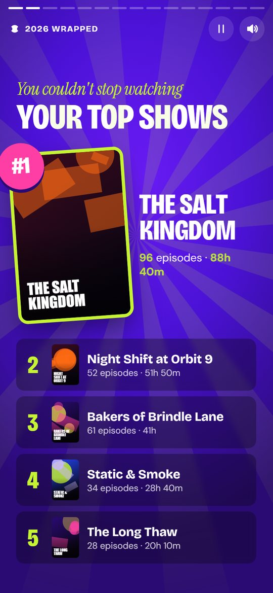
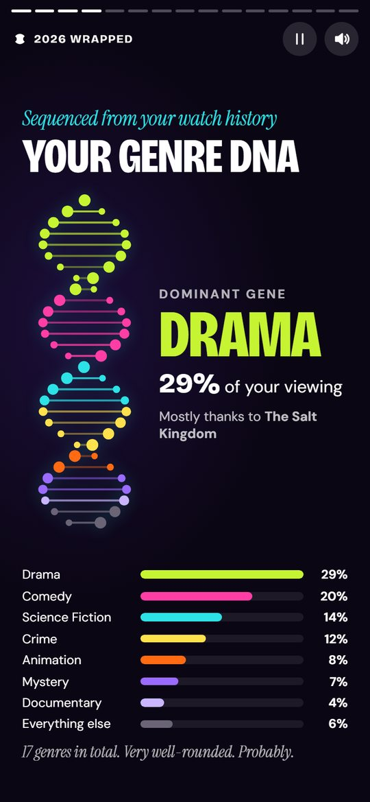
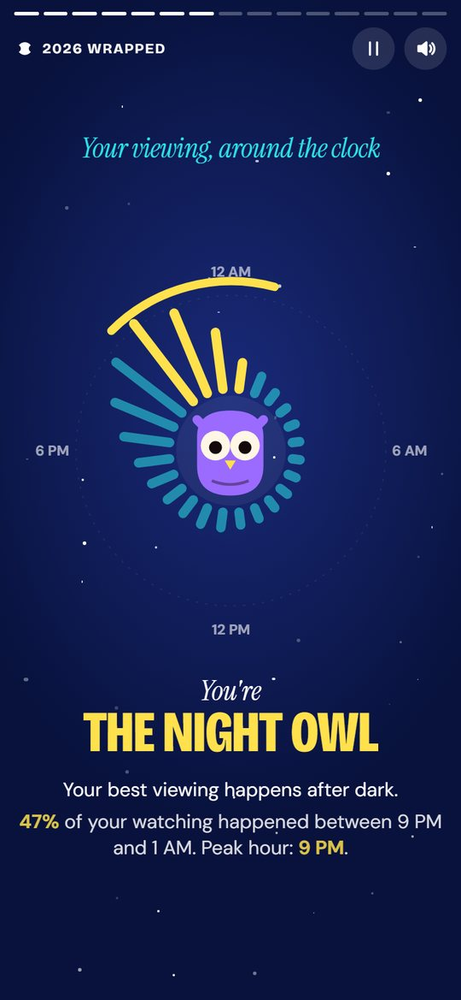
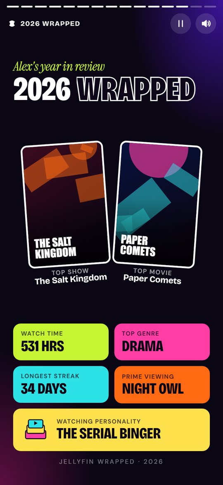
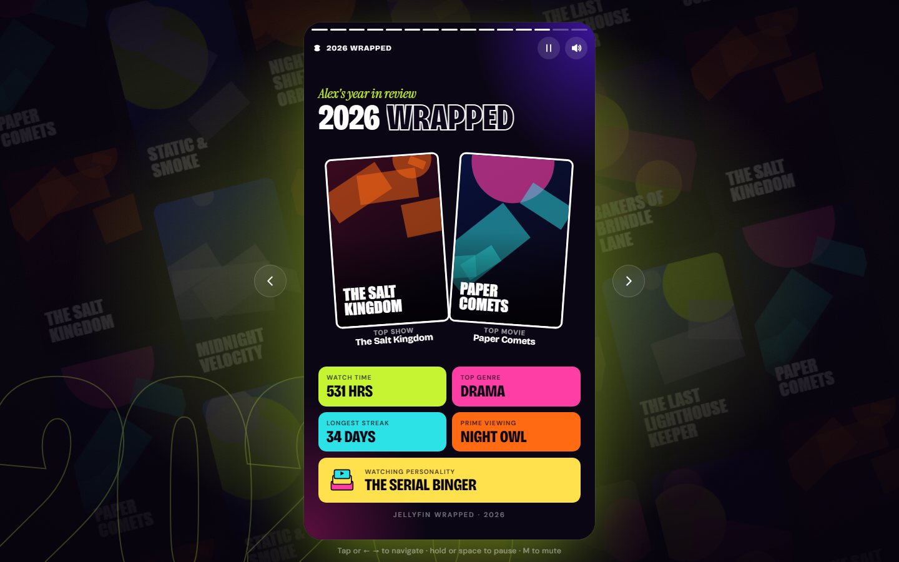

# Jellyfin Wrapped

**A Spotify Wrapped–style year in review for everyone on your Jellyfin server.**

Each person gets their own animated, story-style recap: their top shows and movies, the actor they couldn't stop watching, their longest binge, when they watch, their "watching personality" and more. It has posters, bold animation and a soundtrack made from the music of the shows and movies they watched.

<p align="center">
  
  
  
  
</p>
<p align="center">
  
  
  
  
</p>

<sub>Screenshots use made-up titles and generated artwork.</sub>

## Features

- **14 animated slides:** total watch time, top 5 shows and movies, genre DNA, favourite actor, biggest binge, viewing clock, busiest day, longest streak, most obscure pick, requests, watching personality and a year-in-review card.
- **Made for phones:** tap through like a story, hold to pause. On a computer it plays in a phone-sized frame.
- **A soundtrack for every Wrapped:** music from each person's own titles, found automatically on Deezer. You can also pick songs or use clips from YouTube.
- **Easy to share:** people sign in with their Jellyfin account, or open a short link that shows their Wrapped and nothing else.
- **Admin panel:** prepare any year (or the year so far), choose who gets a Wrapped, preview anyone's, fine-tune the music and sound effects, and see who has watched theirs.
- **One small Docker container.** Everything is prepared ahead of time, so watching a Wrapped never puts load on Jellyfin.

<p align="center"></p>

## What you need

- **Jellyfin** 10.11 or newer
- **[Jellystat](https://github.com/CyferShepard/Jellystat)**, which records the watch history Wrapped is built from. Your Wrapped can only cover the time Jellystat has been running.
- **Seerr / Jellyseerr / Overseerr** (optional). This adds the requests slide, popularity data and better details for titles that may have been deleted.
- **Docker**, on amd64 or arm64.

## Install

### 1. Add it to Docker Compose

```yaml
services:
  jellyfin-wrapped:
    image: ghcr.io/calebvetter/jellyfin-wrapped:latest
    container_name: jellyfin-wrapped
    restart: unless-stopped
    env_file: .env
    ports:
      - "3000:3000" # or leave this out and point your reverse proxy at port 3000
    volumes:
      - wrapped-data:/data
    read_only: true
    tmpfs:
      - /tmp
    security_opt:
      - no-new-privileges:true

volumes:
  wrapped-data:
```

Prefer a folder instead of a named volume? Use `./jellyfin-wrapped:/data`, and make sure the folder is writable by user `1000`, which the app runs as.

### 2. Add your settings to `.env`

Put these in the `.env` file next to your compose file. Compose only passes them into the container because of the `env_file: .env` line above.

```ini
# Addresses as seen from inside the container (container names work if they share a network)
JELLYFIN_URL=http://jellyfin:8096
# Jellyfin → Dashboard → API Keys
JELLYFIN_API_KEY=
JELLYSTAT_URL=http://jellystat:3000
# Jellystat → Settings → API Keys
JELLYSTAT_API_KEY=

# Optional: Seerr → Settings → General
SEERR_URL=http://seerr:5055
SEERR_API_KEY=

# The address people will open, exactly as typed in the browser
ORIGIN=https://wrapped.example.com

# Generate one with: openssl rand -hex 32. Don't change it later, or existing links stop working.
APP_SECRET=

# Recommended behind a reverse proxy, so sign-in rate limiting sees real visitors, not the proxy
ADDRESS_HEADER=X-Forwarded-For
XFF_DEPTH=1
```

Every option is explained in [.env.example](.env.example).

### 3. Start it

```bash
docker compose up -d jellyfin-wrapped
```

Put it behind your reverse proxy at the address you set as `ORIGIN`, using HTTPS.

### 4. Make the Wrappeds

1. Open the site and **sign in with a Jellyfin administrator account**.
2. On the admin page, check the **timezone** (it starts as your browser's), click **Test connections**, then **Prepare** the year you want.
3. Optionally, visit **Soundtrack** to check the music and **Users** to choose who's included.
4. Share it. People can sign in with their own Jellyfin account, or send each person their link from the **Users** page. **Copy email** copies a ready-made, nicely formatted email to paste into your mail client.

Run **Prepare** again whenever you want to update the numbers, for example at the end of the year.

### Updating

```bash
docker compose pull jellyfin-wrapped && docker compose up -d jellyfin-wrapped
```

Your prepared Wrappeds, links and music choices are kept in the data folder.

## Good to know

- **Privacy:** a Wrapped only shows that person's own viewing; others appear only as anonymous counts. Links are view-only: they can't sign anyone in or reach your servers, so they're safe to share. Revoke one anytime on the user's page.
- **Music:** soundtrack lookups send movie and show titles (nothing else) to Deezer's public API. Set `DEEZER_ENABLED=false` to turn this off. YouTube clips are downloaded only when an admin pastes a link.
- **Sign-in rejected (403)?** `ORIGIN` must exactly match the address in the browser, including `https://`.
- **Can't reach Jellyfin?** `localhost` inside the container means the container itself. Use the container name or your server's LAN IP.
- **Days or times look off?** Check the timezone on the admin dashboard, and on the person's user page if they live elsewhere, then prepare again. The viewing-clock slide also adjusts to each viewer's own timezone.
- **YouTube grabs failing?** Update the image. It's rebuilt weekly with the latest yt-dlp.

---

## Development

Needs Node.js 22.13+ (24 recommended) and pnpm 10.

```bash
pnpm install
cp .env.example .env.development.local   # your server URLs and API keys
pnpm dev:start                           # dev server in the background, with hot reload
```

| Command                                       | What it does                                                                   |
| --------------------------------------------- | ------------------------------------------------------------------------------ |
| `pnpm dev:start` / `dev:stop` / `dev:restart` | Run the dev server in the background (restart after changing `.env*`)          |
| `pnpm dev:status` / `dev:logs`                | URLs (including LAN addresses for testing on a phone) and recent logs          |
| `pnpm check`                                  | Type check (svelte-check)                                                      |
| `pnpm test`                                   | Unit tests                                                                     |
| `pnpm screenshots`                            | Playwright screenshots of every slide, mobile and desktop, into `screenshots/` |

**Mock preview:** open `http://localhost:5173/preview` to see the full experience with made-up data and no servers needed. Useful parameters: `?slide=4&hold=1` (jump to a slide and pause it), `?variant=light|heavy`, `?personality=tastemaker`, `?name=Sam`, `?noart=1`.

**End-to-end test** against fake Jellyfin, Jellystat, Seerr and Deezer servers, which doesn't touch your real servers or data:

```bash
pnpm build
node scripts/fake-upstreams.mjs &     # fake services on :8099 (users alice…erin, password = name)
bash scripts/e2e-server.sh &          # the app on http://127.0.0.1:3300
node scripts/e2e-admin.mjs --base http://127.0.0.1:3300
```

**Docker image:** every push to `main` runs the checks and tests, then publishes a multi-arch image to `ghcr.io/calebvetter/jellyfin-wrapped`. Tags are `latest`, `sha-<commit>`, and versions from `v*` tags. See [.github/workflows/docker-publish.yml](.github/workflows/docker-publish.yml). To build locally, run `docker compose up -d --build` (this uses [docker-compose.yml](docker-compose.yml) and a `.env` file).

How everything works (metrics, the preparation pipeline, audio, security) is documented in [ARCHITECTURE.md](ARCHITECTURE.md). Contributors and coding agents should read [AGENTS.md](AGENTS.md) first.
